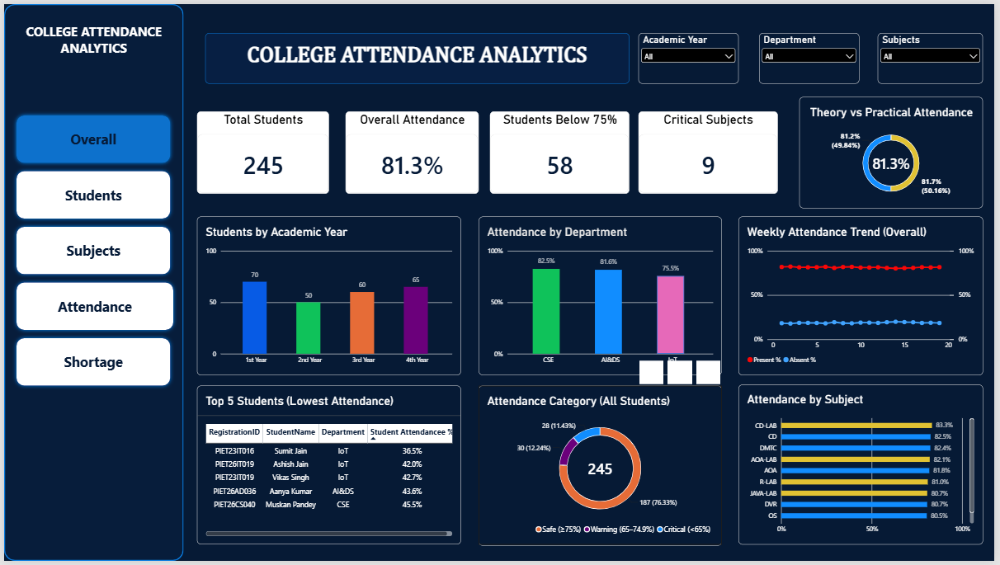
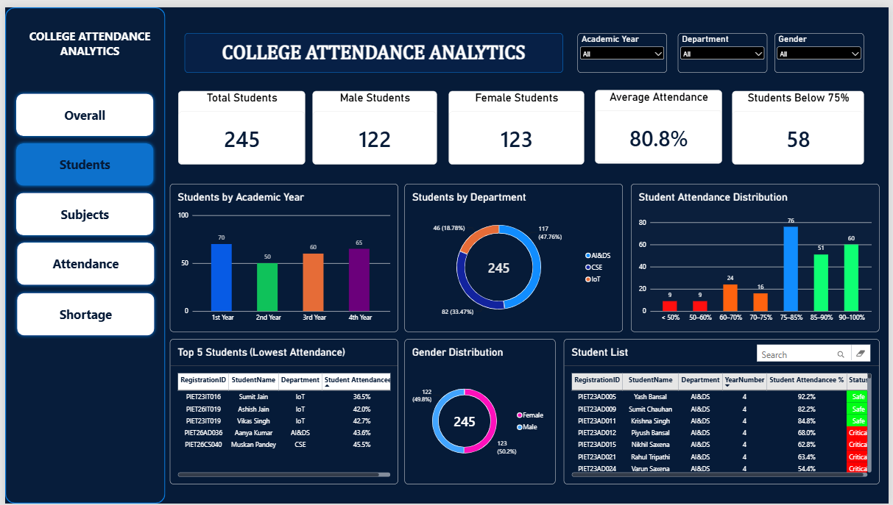
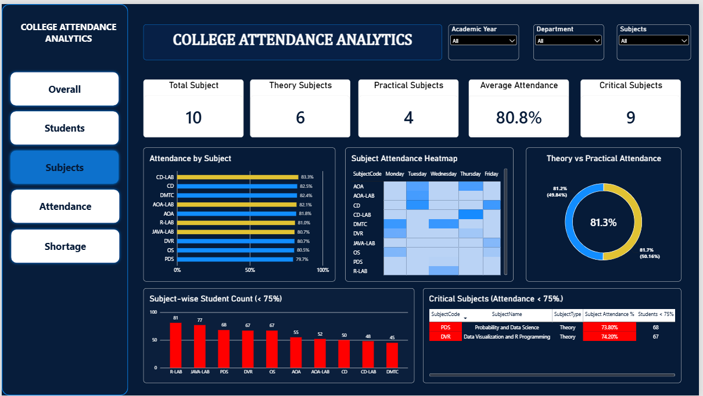
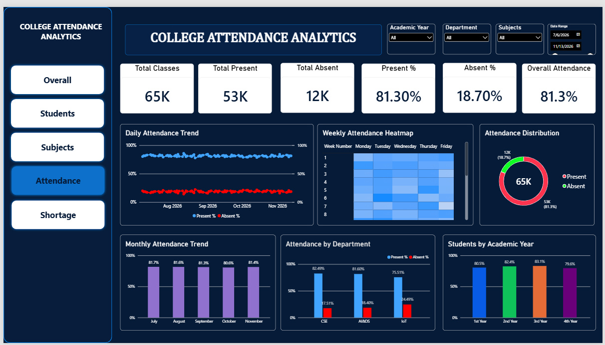
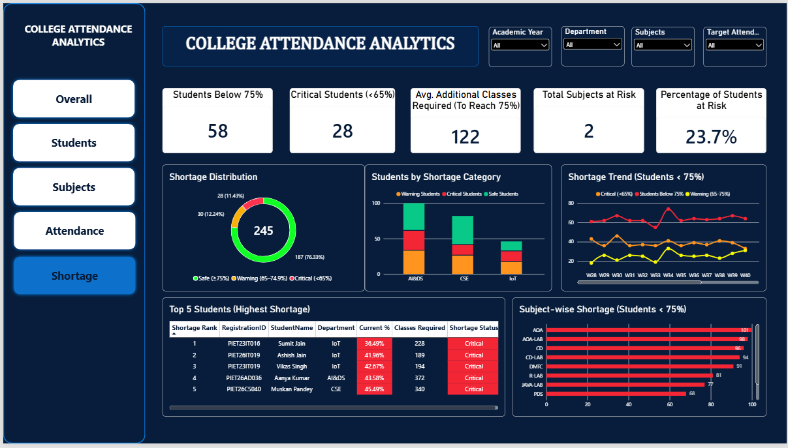

# 📊 College Attendance Analytics Dashboard — Power BI

An interactive **College Attendance Analytics Dashboard** developed using Microsoft Power BI, Power Query, and DAX to analyse student attendance, monitor academic performance, and identify attendance shortages.

The project presents attendance insights through five dashboard pages: Overall, Students, Subjects, Attendance, and Shortage.

---

## 👨‍💻 Project Information

| Detail | Information |
|---|---|
| **Project Title** | College Attendance Analytics Dashboard |
| **Developed By** | Anurag Gupta |
| **Registration Number** | PIET24CD007 |
| **Institution** | Poornima Institute of Engineering & Technology (PIET) |
| **Primary Tool** | Microsoft Power BI |
| **Data Preparation** | Power Query |
| **Calculations and Analytics** | DAX |
| **Departments Covered** | CSE, AI&DS, IoT |
| **Students Represented** | 245 |
| **Subjects Covered** | 10 |

## 📌 Project Overview

The College Attendance Analytics Dashboard transforms attendance records into interactive visual reports that help users explore attendance patterns across students, departments, academic years, and subjects.

The dashboard includes KPI cards, charts, tables, attendance trends, and interactive filters. It also highlights students below the 75% attendance threshold, critical attendance cases below 65%, and subjects requiring attention.

## 🎯 Objectives

- Monitor overall student attendance through interactive visualizations.
- Analyse attendance across academic years and departments.
- Compare attendance performance across subjects.
- Identify students whose attendance is below 75%.
- Highlight critical attendance cases below 65%.
- Analyse present and absent attendance records.
- Examine attendance shortages and additional classes required to reach the target.
- Support detailed analysis through interactive slicers and dashboard navigation.

## 🛠️ Technologies Used

- **Microsoft Power BI Desktop** — Dashboard development and visualization.
- **Power Query** — Data import and preparation.
- **DAX (Data Analysis Expressions)** — Measures and attendance calculations.
- **Microsoft Excel** — Dataset storage and input.

## 📂 Repository Structure

```text
College-Attendance-Analytics-PowerBI/
│
├── Dataset/
│   └── Attendance_Analytics_PowerBI.xlsx
│
├── PowerBI/
│   └── ANURAG_GUPTA_PBI.pbix
│
├── Screenshots/
│   ├── overall_dashboard.png
│   ├── students_dashboard.png
│   ├── subjects_dashboard.png
│   ├── attendance_dashboard.png
│   └── shortage_dashboard.png
│
├── Report/
│   └── College_Attendance_Analytics_Project_Report_Anurag_Gupta.pdf
│
├── README.md
└── LICENSE
```

## 📊 Dashboard Pages

### 1. Overall Dashboard

Provides a high-level overview of college attendance through KPI cards and visual summaries.

**Key components:**
- Total Students
- Overall Attendance
- Students Below 75%
- Critical Subjects
- Students by Academic Year
- Attendance by Department
- Weekly Attendance Trend
- Attendance Category Distribution
- Attendance by Subject



### 2. Students Dashboard

Focuses on student demographics and individual attendance performance.

**Key components:**
- Total Students
- Male and Female Students
- Average Attendance
- Students Below 75%
- Students by Academic Year
- Students by Department
- Gender Distribution
- Student Attendance Distribution
- Lowest-Attendance Student Table



### 3. Subjects Dashboard

Analyses attendance performance at the subject level.

**Key components:**
- Total Subjects
- Theory Subjects
- Practical Subjects
- Average Attendance
- Critical Subjects
- Attendance by Subject
- Subject Attendance Heatmap
- Subject-wise Student Count Below 75%
- Critical Subjects Table



### 4. Attendance Dashboard

Examines attendance records and trends over time.

**Key components:**
- Total Classes
- Total Present Records
- Total Absent Records
- Present Percentage
- Absent Percentage
- Daily Attendance Trend
- Weekly Attendance Heatmap
- Monthly Attendance Trend
- Attendance by Department
- Students by Academic Year

The dashboard includes a date-range filter for examining attendance during a selected period.



### 5. Shortage Dashboard

Focuses on attendance risk and identifying students and subjects requiring attention.

**Key components:**
- Students Below 75%
- Critical Students Below 65%
- Average Additional Classes Required
- Total Subjects at Risk
- Percentage of Students at Risk
- Shortage Distribution
- Students by Shortage Category
- Shortage Trend
- Top 5 Students with Highest Shortage
- Subject-wise Shortage Analysis



## 🧮 Key DAX Measures

The following measures are used in the project.

### 1. Overall Attendance %

```dax
Overall Attendance % =
DIVIDE(
    SUM(F
